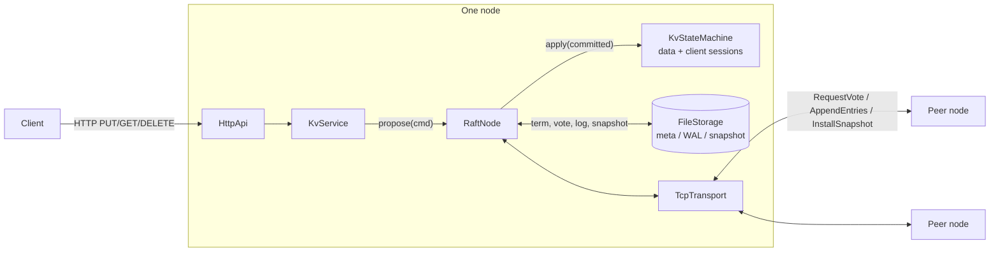

# raft-kv

A fault-tolerant, **linearizable key-value store built on the Raft consensus algorithm**, written from scratch in Java 21 with no runtime dependencies.

[](https://github.com/abhiv1234/raft-kv/actions/workflows/ci.yml)

A 3-node cluster keeps serving reads and writes when any single node dies, never loses an acknowledged write, and never applies a retried request twice. The test suite proves this by crashing nodes, partitioning the network and dropping messages while clients keep writing, then checking invariants.

> **Status:** a complete, tested implementation of the Raft protocol for learning and portfolio purposes. It is *not* production-ready: see [Limitations](#limitations).

## Features

| Area | What is implemented |
|---|---|
| **Consensus** | Leader election, log replication, commit rules incl. the leader no-op (Raft paper §5, §8) |
| **Robustness** | **Pre-vote** (a partitioned node cannot disrupt a healthy cluster), **check-quorum** (a cut-off leader steps down by itself), accelerated log backtracking |
| **Durability** | Crash-safe write-ahead log: CRC-checked records, torn-write detection, atomic meta/snapshot files, fsync before acknowledging |
| **Compaction** | Log snapshots plus `InstallSnapshot` to bring lagging or new followers up to date |
| **Client semantics** | Linearizable reads and writes; **exactly-once** retries through client sessions (`clientId` + `seq`); compare-and-swap |
| **Interfaces** | HTTP API with automatic leader redirect; `/status` endpoint |
| **Testing** | Simulated network with partitions, message loss and latency; randomized chaos test; storage crash-recovery tests; mutation-checked (see [Testing](#testing)) |

## Architecture



Package layout:

```
src/main/java/dev/raftkv/
  raft/      RaftNode (the protocol), RaftLog, Rpc messages, Storage/Transport/StateMachine interfaces
  storage/   FileStorage (WAL + atomic files), MemoryStorage (for tests)
  net/       TcpTransport (real network), InMemoryNetwork (fault-injecting simulator)
  kv/        KvStateMachine, KvCommand/KvResult, KvService
  server/    HttpApi, KvServer (wiring), NodeConfig, Main
src/test/java/dev/raftkv/   election, replication, partition, snapshot, persistence, chaos, storage, HTTP integration tests
docs/DESIGN.md             design decisions, trade-offs, failure walkthroughs
docs/INTERVIEW_GUIDE.md    how to present and defend this project
```

## Quick start

Requires **Java 21** and **Maven 3.9+**.

```bash
mvn -q package -DskipTests          # builds target/raft-kv-1.0.0.jar
./scripts/start-cluster.sh          # starts 3 nodes: HTTP on :8001 :8002 :8003, Raft on :7001-:7003
```

Talk to **any** node. A follower answers with a `307` redirect to the leader, which `curl -L` follows:

```bash
curl -L -X PUT --data-binary 'hello' http://localhost:8001/kv/greeting
curl -L http://localhost:8002/kv/greeting                  # -> hello   (linearizable read)
curl http://localhost:8003/status                          # role, term, leader, commit index
```

Run the failover demo (kills the leader with `kill -9`, keeps writing, restarts the dead node):

```bash
./scripts/demo-failover.sh
./scripts/stop-cluster.sh           # WIPE=1 ./scripts/stop-cluster.sh also deletes data/
```

Example output:

```text
== 1. write 5 keys (through any node; followers redirect to the leader)
   key3 -> value-3
== 2. current leader: n2. Killing it (kill -9)...
== 3. waiting for a new leader
   new leader: n3
== 4. cluster keeps serving: old data readable, new writes accepted
   key3 -> value-3
   after-failover -> written-during-outage
== 5. restarting n2; it recovers from disk and catches up from the new leader
   n2 local copy of 'after-failover' -> written-during-outage
   n2 status: {"id":"n2","role":"FOLLOWER","term":2,"leader":"n3","commitIndex":11,"lastApplied":11,"lastLogIndex":11,"snapshotIndex":0}
```

### Docker

```bash
docker compose up --build
curl -L -X PUT --data-binary hello http://localhost:8001/kv/greeting
docker compose kill node1            # the cluster keeps serving
```

### Running a node by hand

```bash
java -jar target/raft-kv-1.0.0.jar \
  --id n1 --data-dir data/n1 \
  --peers n1=127.0.0.1:7001:8001,n2=127.0.0.1:7002:8002,n3=127.0.0.1:7003:8003
```

`--peers` lists **every** member, including this node, as `id=host:raftPort:httpPort[:publicHost]`. The optional fourth field is the address clients use to reach that node's HTTP port (used in redirects; defaults to `host`). Other flags: `--no-fsync` (benchmarks only; unsafe), `--snapshot-threshold <entries>`.

## HTTP API

| Request | Meaning |
|---|---|
| `PUT /kv/{key}` (body = value) | Store a value. `200 {"ok":true}` |
| `PUT /kv/{key}?ifValue=old` | Compare-and-swap. `200` if swapped, `409` with the current value if not |
| `PUT /kv/{key}?ifAbsent=true` | Create only if the key does not exist (`409` otherwise) |
| `GET /kv/{key}` | **Linearizable** read (goes through the log). `200` value or `404` |
| `GET /kv/{key}?stale=true` | Local read on whichever node you hit: fast, but may be stale |
| `DELETE /kv/{key}` | Delete. `200 {"ok":true,"existed":true|false}` |
| `GET /status` | `{"role","term","leader","commitIndex","lastApplied","lastLogIndex","snapshotIndex"}` |

Status codes worth knowing: `307` follower redirect to the leader (header `X-Raft-Leader`); `503` no leader elected yet (`Retry-After: 1`); `504` timed out waiting for commit.

**Safe retries.** A `504` or a dropped connection means the outcome is *unknown*: the write may still commit. Send `X-Client-Id: <stable id>` and `X-Request-Seq: <n>` and re-send the identical request with the same pair; the state machine applies each `(clientId, seq)` once and replays the original result for duplicates.

```bash
curl -L -X PUT -H 'X-Client-Id: worker-1' -H 'X-Request-Seq: 41' --data-binary 'v' http://localhost:8001/kv/k   # retry-safe
```

## Testing

```bash
mvn verify                                   # everything
mvn test -Dtest=ChaosTest -Dchaos.ms=30000   # longer chaos run; prints its random seed
mvn test -Dtest=ChaosTest -Dchaos.seed=<n>   # replay a failing schedule
```

| Suite | What it proves |
|---|---|
| `ElectionTest` | One leader per term, observed continuously through repeated failovers; re-election after a crash; no leader without a majority; single-node cluster |
| `ReplicationTest` | Replication to all nodes, CAS/delete, 300 concurrent proposals, follower catch-up, **a deposed leader's uncommitted entries are discarded** |
| `PartitionTest` | A minority cannot commit while the majority continues; a cut-off leader steps down; **pre-vote on/off control experiment**; survives 15% message loss plus latency |
| `SnapshotTest` | Log compaction, lagging follower recovered through `InstallSnapshot`, restart from snapshot + log |
| `Figure8Test` | **Deterministic reproduction of Raft paper Figure 8**: a leader must not commit an old-term entry just because a majority holds it |
| `PersistenceTest`, `FileStorageTest` | Full-cluster restart, real files, **a node can't vote twice in a term across a restart**, torn writes, corrupted records, a crash between "snapshot written" and "log compacted" |
| `KvStateMachineTest` | Command encoding, de-duplication, stale requests, session state surviving snapshots |
| `ServerIntegrationTest` | Three real nodes (TCP + HTTP + disk): redirect, CAS, idempotent retry, kill the leader and recover |
| `ChaosTest` | Random crashes, partitions and message loss while clients write. Verifies **no acknowledged write is lost**, a **CAS counter equals the acknowledged increments exactly** (no lost updates, no double-apply on retry) and **all replicas end identical** |

The tests were checked for sensitivity by injecting deliberate bugs. Each of these is caught: committing without a majority, never truncating a follower's conflicting entries, disabling client-session de-duplication, dropping the current-term commit rule, and not persisting a vote.

## Limitations

Deliberate scope limits, each discussed in [docs/DESIGN.md](docs/DESIGN.md):

- **Static membership.** No joint-consensus configuration changes.
- **Reads go through the log.** Correct and simple, but slower than ReadIndex or lease reads.
- **Snapshots are taken under the node lock** and sent as a single message; fine for modest state, not for GBs.
- **Java serialization over plain TCP with no authentication or TLS.** There is a strict class allow-list, but keep the Raft port on a trusted network.
- **No linearizability checker.** Safety is validated with targeted invariants and fault injection, not a full Jepsen/Knossos-style history check.
- One connection per RPC, and no batching or pipelining tuning, so throughput is not the focus.

## Ideas for extending it

1. Add ReadIndex (or lease) reads and measure the latency difference against log reads.
2. Add a history recorder and run a linearizability checker (e.g. Porcupine/Knossos) over the chaos test output.
3. Implement cluster membership changes (single-server changes or joint consensus).
4. Replace Java serialization with a compact protobuf codec; add mTLS between nodes.
5. Add a benchmark harness and publish your own throughput and latency numbers in this README.

## References

- Diego Ongaro and John Ousterhout, *In Search of an Understandable Consensus Algorithm* (the Raft paper)
- Diego Ongaro, *Consensus: Bridging Theory and Practice* (PhD thesis; pre-vote, check-quorum, client sessions, membership)
- Martin Kleppmann, *Designing Data-Intensive Applications*, chapters 5 and 9

## License

MIT. See [LICENSE](LICENSE).
